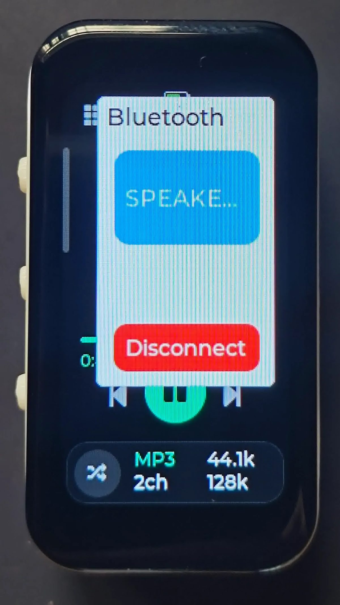
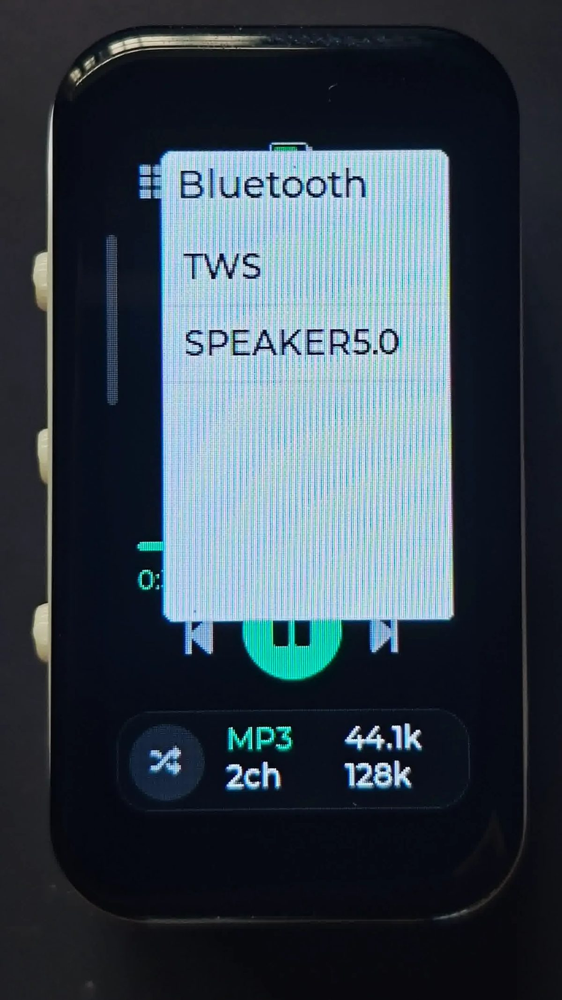
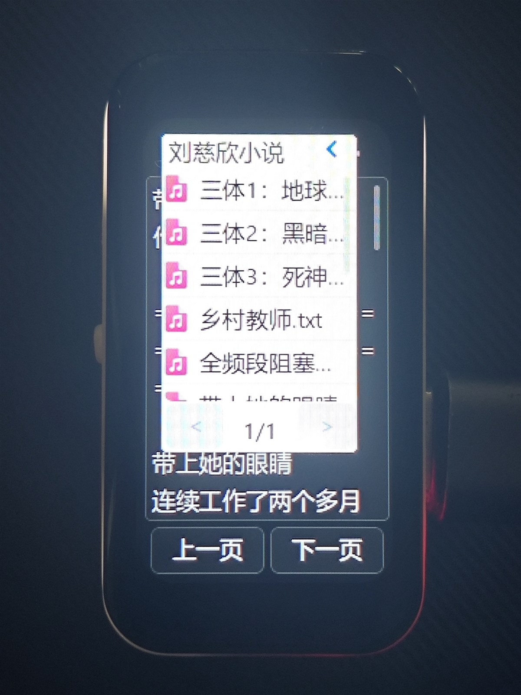
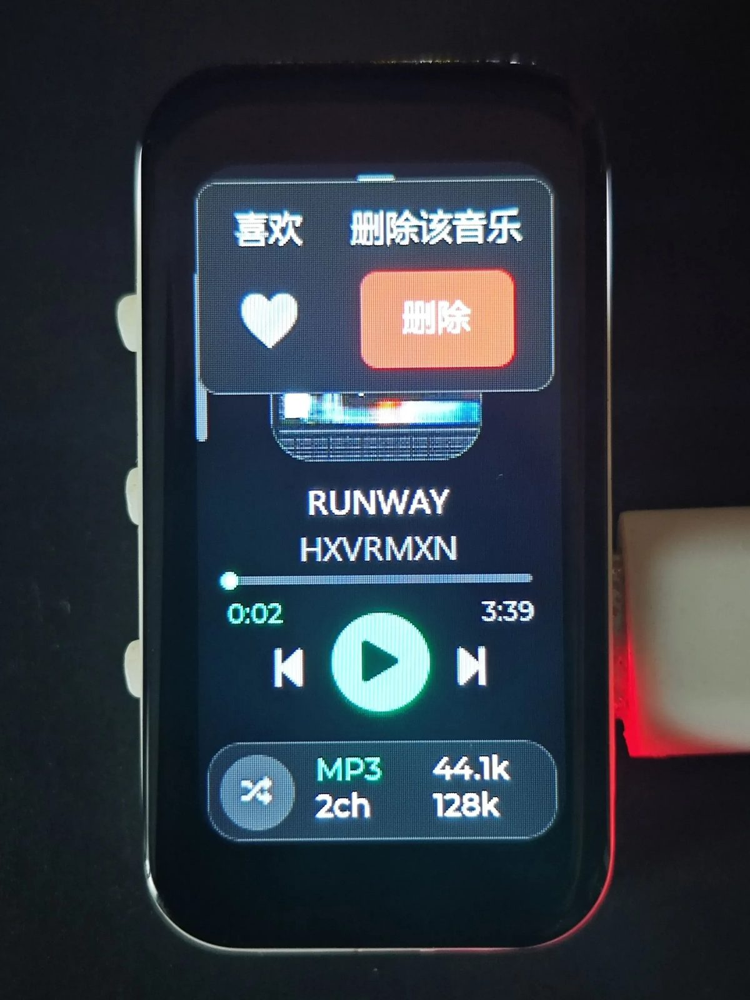
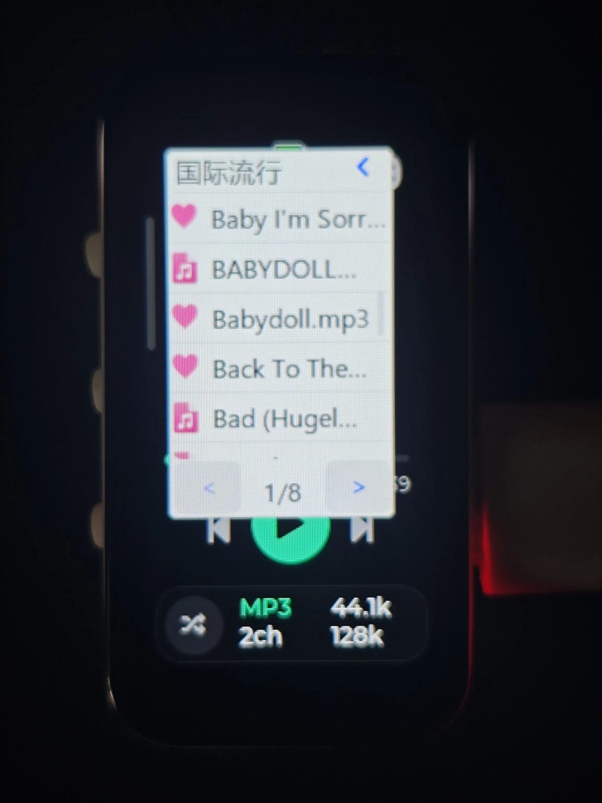

<div align="center">

# music_nano

比拇指大小的迷你音乐播放器 · ESP32 + 蓝牙 Classic A2DP

</div>

## 项目概述

music_nano 是一款比拇指大小的迷你音乐播放器，整机仅 2.2cm × 4.2cm、厚 8mm（不含电池），能轻松塞进任何口袋。它由 ESP32 驱动，通过蓝牙 Classic A2DP 把音乐无线推送给耳机或音箱。

<p align="center">
  
  
  
  
</p>

## 演示视频

[哔哩哔哩 · BV1nEtp6qE72](https://www.bilibili.com/video/BV1nEtp6qE72?t=42.2)

## 硬件开源

PCB 与 3D 外壳已在立创开源硬件平台开源：

**[立创开源硬件平台 · music_nano](https://oshwhub.com/coconet/project_bxhxmpkd)**

## 功能特性

- **音频解码**：MP3 / FLAC / WAV，最高支持 48kHz / 16bit / 320kbps
- **蓝牙输出**：Classic A2DP 无线播放，支持设备扫描与一键连接
- **耳机控制**：通过 AVRCP 在耳机上直接播放/暂停/上一曲/下一曲/音量±
- **文件浏览**：MicroSD 音乐库，按目录分组，支持热插拔检测与自动扫描缓存
- **专辑封面**：自动解析 MP3/FLAC 内嵌封面并显示
- **歌词显示**：读取 MP3（USLT）/ FLAC 内嵌歌词，按时间轴逐行滚动并高亮当前行
- **播放模式**：顺序 / 单曲循环 / 随机
- **设置持久化**：音量、亮度、上次播放歌曲、播放模式、启动模式（音乐/小说）掉电保存（NVS）
- **主菜单**：长按睡眠键进入三图标主菜单（音乐 / 小说 / 设置），点图标进对应模式；设置页目前只有「固件版本」一项
- **系统监视**：实时显示电池电压与 CPU 温度
- **电源管理**：背光渐变、一键息屏（蓝牙保持连接）、深度睡眠
- **OTA 双槽**：`ota_0` / `ota_1` + otadata 选槽，新固件首次启动跑 15 秒校验窗口，未确认就崩溃/断电由 bootloader 自动退回旧槽
- **串口控制台**：内置命令可直接操作扫描/连接/播放/调试

## 硬件平台

| 项目 | 规格 |
| --- | --- |
| 主控 | ESP32 双核 240MHz 2M PSRAM |
| 显示屏 | 172×320 全彩 LCD（JD9853，SPI 接口） |
| 音频输出 | 蓝牙 Classic A2DP（无线） |
| 外部存储 | MicroSD 卡（热插拔检测） |
| 电池 | 滑块式可插拔，无内置固定电池 |
| 按键 | 息屏 / 唤醒键 |
| 交互 | 全图形化 LVGL 界面 |

## 尺寸与外观

- 宽：2.2cm
- 长：4.2cm
- 厚：8mm（不含电池）

## 电池与续航

采用**滑块式可插拔电池**设计，电池像推卡片一样滑入滑出，随时可更换。整机不带固定电池。
续航取决于你随身带几块电池——带一块听一块，没电了换一块接着听。

## 功耗

以下功耗均在播放 MP3 44.1kHz / 128kbps 音乐的条件下实测：

不使用蓝牙：

| 场景 | 功耗 |
| --- | --- |
| 不使用蓝牙，亮度最大 | ≈ 0.7W |
| 不使用蓝牙，亮度中等 | ≈ 0.3W |
| 不使用蓝牙，亮度最低 | ≈ 0.25W |
| 关闭蓝牙并休眠 | ≈ 3mW |

开启蓝牙：

| 场景 | 功耗 |
| --- | --- |
| 开启蓝牙，亮度最低 | ≈ 0.6W |
| 开启蓝牙，亮度中等 | ≈ 0.7W |
| 开启蓝牙，亮度最大 | ≈ 1.0W |
| 开启蓝牙，播放音乐并息屏 | ≈ 0.6W |

## 解码能力

- 最高支持 **48kHz / 16bit / 320kbps** 的 MP3 与 FLAC
- 播放该规格音乐时，音频解码任务 CPU 占用约 **60%**，中间转换层约 **15%**
- 再高（例如 96kHz）会开始卡顿

ESP32 无 FPU，所有解码与重采样均为纯整数定点实现，音频最终统一重采样到 44.1kHz / 16bit / 立体声后通过蓝牙推送。

## 软件架构

基于 ESP-IDF + FreeRTOS，按功能域拆分为多个独立任务，任务间通过队列解耦：

- **蓝牙任务**：A2DP / AVRCP 协议栈、设备扫描与连接管理
- **音频任务**：解码（MP3/FLAC/WAV）→ 定点重采样 → 推流
- **UI 任务**：LVGL 图形界面与交互
- **封面解码任务**：独立解码内嵌专辑封面，不阻塞播放
- **系统监视任务**：SD 卡管理、电池电压 / CPU 温度采样

启动流程做了专门优化：bootloader 阶段即完成 LCD 硬件上电时序，把开机黑屏时间压缩到最短。

## 目录结构

- `main/audio/` 解码器与定点重采样
- `main/bt/` 蓝牙 A2DP
- `main/ui/` LVGL 界面
- `main/power/` 电源管理
- `main/storage/` SD 卡与音乐扫描
- `main/drivers/` 显示屏驱动
- `main/app/` 设置持久化、串口控制台、OTA 校验窗口
- `main/resources/font_part.c` 字库分区加载（mmap 进 DROM 窗口）
- `tools/flash_tool/` 一键烧录器（Windows x86-64，MinGW 编译）
- `tools/flash_step.ps1` 分步烧录脚本（首次全量 / 只写某槽 / 只擦某段）
- `tools/serial_cmd.ps1` 串口助手（给设备控制台发命令）
- `tools/reset_log.ps1` 复位并抓启动日志
- `tools/make_variants.ps1` 批量生成 OTA 测试用的版本变体

## 构建说明

需要 **ESP-IDF 5.5.5**（必须正好这个版本：WiFi 协议栈是随 IDF 发布的预编译库，
与同版本 `wifi_os_adapter.h` 的表布局绑定，本工程还整表替换了分配器并 `--wrap=free`；
低版本另有 SPI 总线死锁 bug）。

```powershell
. $env:IDF_PATH\export.ps1   # 导出 ESP-IDF 环境
idf.py set-target esp32
idf.py build
idf.py -p COMx flash monitor
```

本仓库还提供 `build.ps1`（过滤噪声的构建包装脚本）与 `mem-analyze.ps1`（ELF 内存占用分析），详见 [BUILD.md](BUILD.md)。

## 烧录与升级

两者是分开的两条链路，不要混用：

| 用途 | 手段 |
| --- | --- |
| 芯片全空 / 换分区表 | 线烧全量：`tools\flash_step.ps1 once`（bootloader + 分区表 + ota_0 + 字库） |
| 保留设置的重新烧录 | `tools\flash_step.ps1 base`（同上去掉字库，可加 `-NoFont`） |
| 日常升级 | OTA（写备用槽，见下） |
| 调试 | `app2 -Slot 0\|1` 写指定槽 / `erase` 只擦一段 / `raw` 单文件单地址 |

分区表（8MB，OTA 双槽，0.7.13 起）：

```
nvs     0x009000 144KB    phy_init 0x02D000 4KB     otadata 0x02E000 8KB
ota_0   0x030000 2.88MB   ota_1    0x310000 2.88MB   font    0x5F0000 2.06MB
```

> 决定 `ota_0` 起点的是"前面所有小分区的终点向上取整到 64KB"，而不是某个固定地址。
> 旧表把 `phy_init` 放在 `0x21000`，终点越过 `0x20000`，`ota_0` 就只能退到 `0x40000`，
> 白扔 `0x22000-0x40000` 这 120KB。现在 nvs 扩到 144KB 顶到 `0x2D000`，小分区终点
> 正好 `0x30000`，**对齐空洞为 0，8MB 一字节不剩**。
>
> 烧录器会拦截任何落到 `0x30000` 以下、又不在白名单（`0x1000` bootloader /
> `0x8000` 分区表 / `0x2D000` phy_init / `0x2E000` otadata）里的地址——旧版
> `flash_args`（app 曾经在 `0x20000`，现在那里是 nvs）会被直接拒绝，而不是像以前
> 那样写进去、回读 MD5 还全对、重启才发现设备起不来。

字库单独占一个 **2.0625MB**的只读分区，开机 mmap 进 DROM 窗口（1.88MB / **31 页**）。它**只由
烧录器全量烧写时写入**，OTA 不碰它，所以换字库必须线烧。

> 字库分区按"定型"来做：内容 1,966,373 B，分区 2,162,688 B，余 **9.1%**（约 1,900 个字形）。
> 0.7.13 把字库从 4bpp 降到 **2bpp**（bitmap 2,803,930 → 1,504,277 B），DROM 占用 50 → 31 页，
> 同时把分区从 3.19MB 收到 2.0625MB，**腾出的 520KB 全给了 app 槽**（各 +256KB，
> `0x250000`（2.31 MiB）→ `0x2E0000`（2.875 MiB），app 余量 6% → 20.8%。
> 16px 在 1.47"/247ppi 屏上只有 1.645mm，2bpp 的灰阶损失在实机距离下看不出来（放大 5× 才明显）。
> **这是布局变更**，从旧版升上来必须 `tools\flash_step.ps1 once` 整片擦除重烧，OTA 跨不过去。
> flash 到此再无余量：以后想要更多 app 空间，只能动字库内容（删韩文/裁字表）。

> 所有自己写的脚本都在 `tools/` 下，**不要放进 `build/`**：那是编译目录，
> `idf.py fullclean` 或 IDE 的清理会整个删掉。

## 更新日志

### 2026.11.14

**自动熄屏（0.7.15）**
- 设置页第三项「自动熄屏」：**通用 / 小说 / 歌词** 三条分支，各 **1~10 分钟**，存 NVS（`off_common` / `off_novel` / `off_lyr`）
- "通用 + 特殊"两层次：通用兜住菜单、设置、音乐封面**以及以后新加的任何模式**；小说和歌词只是两条覆盖 —— `idle_poll_cb` 里只列举两条特殊分支，其余默认走通用，加新模式不用再动那个 if
- 菜单和设置原来固定 30 秒，并进通用分支后最短一档就是 1 分钟（默认 2 分钟），这是"通用"带来的必然变化
- 时长缓存在 RAM（开机从 NVS 灌一次），1 秒轮询不碰 flash；保存后立刻生效，不用重启
- 数值弹层去掉半透明黑背景：只留一张白卡，点卡片外仍然关闭 —— 遮罩对象还在，只是 `bg_opa = LV_OPA_TRANSP`，白底设置页不再整页压暗

**下拉弹层（0.7.14 的自动休眠同款）**
- 小时/分钟/三条熄屏分支共用一个通用下拉：`pick_open(id, sel, base, step, count, fmt)`，候选项由 `base + i*step` 生成，行高在 7 项以上收到 26px（10 项才能塞进 320 的高度）

**浅睡（0.7.16）**
- 电源键短按（蓝牙断开）/ 无操作超时 / 息屏期蓝牙断开：**背光正常淡出** → **浅睡 5 分钟** → 期间按电源键立刻淡入亮屏，程序从断点继续；5 分钟到点才走原来的深睡（GPIO22 断电）。蓝牙已连接时仍然只熄屏，不睡 —— 浅睡会掐断 A2DP 流
- 浅睡不关外设电源：GPIO22 全程保持低，只停 CPU/AHB/APB 时钟（`esp_light_sleep_start()` + ext0(GPIO37 高) + 5 分钟 timer）
- 上机实测（`lsp` 自检命令）：PSRAM 1KB / 内部 RAM 256B 内容全保（靠 `CONFIG_ESP_SLEEP_PSRAM_LEAKAGE_WORKAROUND` + `CONFIG_PM_SLP_SPIRAM_HALFSLEEP_ENABLED`，IDF 醒来调 `esp_psram_impl_resume_from_halfsleep_mode`）；整屏重绘无花屏；触摸 I2C 正常；SD 仍挂载、`stat("/sdcard")=0`；音乐在浅睡前后继续播
- **`esp_timer +10000 ms` 而 `FreeRTOS tick +1 ms`**：IDF 只把系统时间补上来，不补 tick。所以醒来必须自己处理两处计时 —— 无操作计时靠 `power_mgr_notify_activity()`（`screen_on()` 里已有），自动休眠靠 `autosleep_on_wake()` 把结算基准挪到"现在"，浅睡那段不扣剩余量
- 两个坑：ext0 唤醒后 GPIO37 停在 RTC IO，必须 `gpio_config()` 复原成普通输入，否则电源键从此读不到；深睡前要 `esp_sleep_disable_wakeup_source(ALL)`，否则浅睡留下的 5 分钟 timer 会让深睡 5 分钟后自己醒来

**浅睡时长可调（0.7.17）**
- 设置页第四项「浅睡时长」：**0~10 分钟**，存 NVS（`ls_min`）。**0 = 不浅睡、直接深睡**（浅睡之前的老行为），1~10 = 正常淡出后先浅睡 N 分钟再深睡
- 只影响三条入口（短按且蓝牙断开 / 无操作超时 / 息屏期蓝牙断开）；自动休眠到点、低电量关机仍然直接深睡
- 时长缓存在 `power_mgr`（开机从 NVS 灌一次，睡眠路径不碰 flash），保存后下一次进睡就用新值，不用重启

### 2026.11.13

**自动休眠（0.7.14）**
- 设置页新增第二项「自动休眠」：小时 **0~3** / 分钟 **0~60（步进 10）**，两个下拉各列可选值；`0 小时 0 分` 没有意义，「保存」按钮直接置灰不可点
- 落盘只存一个**总分钟数**（10~240）：存小时+分钟两个字段会出现「1 小时 60 分」和「2 小时 0 分」两个等价状态，存总时长就只有一个真值，显示时再拆
- 音乐页长按播放模式按钮弹出的面板从 120 加高到 **152**：顶部左边是「自动休眠」开关，右边是深色 `lv_switch`；打开后左边文字实时变成「将在X小时Y分钟后休眠」，关闭回到「自动休眠」（原来是说明文字，整体下移给开关腾位置）
- 开关状态存 NVS（`sleep_on`），设定时长存 `sleep_min`；开机时若开关是开的，就从**开机那一刻**开始计
- **剩余时间是纯内存量，不进 NVS**：重启即从头算，用户明确要求"重启了不用管它"
- 计时只在音乐模式走：进菜单/设置/小说时**暂停但不清零**，回音乐接着走，不补扣暂停那段；息屏不算离开音乐（蓝牙还在放），照常计
- 到点走与"蓝牙未连接时短按电源键"同一条淡出→深睡路径，但**不看蓝牙**：到点就是关机（GPIO22 断电，音乐结束），不是只熄屏。OTA 校验窗口 / WiFi 流程期间照旧不睡
- 串口 `sleep` 看开关/设定/剩余，`sleep <秒>` 直接改剩余时间 —— 最短一档是 10 分钟，上机验证等不起
- 下拉是自绘弹层，没开 `LV_USE_DROPDOWN`：`lv_conf.h` 里 dropdown/roller 都是 0（开了要全量重编 LVGL），而且 LVGL 8 的下拉列表固定往下展开，分钟那档 7 项在 172×320 上必然探出屏幕

### 2026.11.8

**设置（0.7.3）**
- 菜单里的「设置」不再只是占位：点进去是**白底整屏 `lv_list`**，目前只有一项「固件版本」
- 点「固件版本」→ 详情页：当前运行 APP 的**版本号**和**镜像真实大小**（本次 `2,319,776 字节` + `2.21 MB`），左上角 `‹` 回列表
- 「检查更新」按钮先占位：**点了没有任何反应**（联网 OTA 还没做）
- 设置是第三种模式（`APP_MODE_SETTINGS`），进出走黑场过渡；**仍然不写 NVS**，长按电源键回主菜单
- 设置页 30 秒无操作自动熄屏（与菜单一致；设置里蓝牙已断开，实际是淡出后深睡）
- 大小取 running 分区里镜像的长度：**读镜像头 + 段头自己算**（`esp_image_verify()` 会把整幅镜像 mmap 进 DROM 核 SHA256，64 页 MMU 里字库已占 50 页 → 必然 `No free MMU pages`），只读一百多字节，进设置时算一次并缓存

### 2026.11.7

**主菜单（0.7.2）**
- 长按睡眠键不再直接切换音乐/小说，改为**进入主菜单**：整屏三张图标竖排（音乐 / 小说 / 设置），点图标进对应模式；设置只占位，点了无响应
- 菜单是第四种模式（`APP_MODE_MENU`），进出都走原有的黑场过渡，切出时照旧清理音频 / 封面 / 蓝牙 —— 所以进菜单 = 停止播放，和以前长按切小说一模一样
- **设置和菜单永不写入 NVS**，启动模式仍然只记音乐 / 小说；停在菜单时断电，下次开机回到上次的音乐或小说
- 菜单 30 秒无操作自动熄屏（走原有短按动作；菜单里蓝牙已断开，所以实际是淡出后深睡）
- 图标由 `tools/gen_menu_icons.py` 从 `image/` 的源图生成：裁到徽章外框 → 88×88 → 圆形 alpha 蒙版 → 合成菜单底色，三张共 46KB flash

> ⚠️ 分区表再改一次：`ota_0 @0x30000` / `ota_1 @0x280000` / `font @0x4D0000`。
> 从任何旧版升上来都必须 `tools\flash_step.ps1 once` 整片擦除重烧。

**分区**
- app 槽 2.19MB → **2.31MB**（余量 1.07% → 6.42%），nvs 88KB → **144KB**
- 吃掉两处浪费：`0x22000-0x40000` 对齐空洞 + 末尾闲置 128KB，**248KB 浪费归零**
- 字库分区 3.25MB → 3.19MB（内容 3,266,026 B，余 2.3%），地址 `0x4A0000` → `0x4D0000`

**为网络升级腾 IRAM**
- `ESP_WIFI_IRAM_OPT` / `ESP_WIFI_RX_IRAM_OPT` 关掉（IDF 对 "ESP32+蓝牙+PSRAM" 这
  个组合**本来就是默认关**，本工程是历史遗留的 `y`）
- `FREERTOS_PLACE_FUNCTIONS_INTO_FLASH=y`
- 只做 STA：`SOFTAP_SUPPORT` / `WPA3_SAE` / `SAE_PK` / `SAE_H2E` / `SOFTAP_SAE` /
  `WPA3_OWE_STA` 全关
- `LWIP_IPV6=n`；HTTP 不做 HTTPS，不带 CA 证书包
- 结果：把完整 WiFi + HTTP + OTA 栈链进来后 `.iram0.text` 118,119 B，IRAM 余
  **11.9KB**；改之前不带 WiFi 只剩 2,517 B，一加就爆 27,340 B

### 2026.11.6

> ⚠️ 本版分区表改成 **OTA 双槽**（`ota_0 @0x40000` / `ota_1 @0x270000` / `font @0x4A0000`），
> 从旧版升上来必须先整片擦除重烧一次（`tools\flash_step.ps1 once`），旧 NVS 设置会被清空。

**新增**
- OTA 双槽：新增 `otadata`，`ota_0` / `ota_1` 各 2.19MB，按 `(seq-1)%2` 选槽启动
- 首启校验窗口：新固件第一次启动时盖一层**系统层**全屏遮罩（`lv_layer_sys`）+ 15 秒倒计时，期间禁止睡眠；走完自动 `esp_ota_mark_app_valid_cancel_rollback()` 打标
- 启动失败自动回退：不做任何处理，未打标的镜像在下次重启被判 `ABORTED`，bootloader 自己退回旧槽
- 字库拆到独立 3.25MB 分区（`font`，data 子类型 `0x40`），开机 `esp_partition_mmap` 进 DROM 窗口，app 从 5,013,280 B 瘦到 1,765,136 B（槽占 23%）
- 串口命令：`version` / `ota` / `ota boot <0|1>` / `font crc`
- 烧录器：写大文件按 1MB 分段 + 末段补齐 16KB，修掉 2MB 以上单段写坏末尾几百字节的问题；新增地址白名单拦截（见"烧录与升级"）

**优化**
- 冷启动不做字库全量校验。原先在"OTA 后首启"跑一次 3.27MB CRC（271ms），但 OTA 根本不写字库分区，时机是反的；改成手动命令 `font crc`，启动路径只留纯内存校验（magic / 长度 / 偏移 / mmap / `glyph_dsc` 首末抽检）
- 同槽 `ota boot` 直接拒绝，不再写一条指向"正在运行的分区"的 otadata

**修复**
- `flash_step.ps1` 的 `$src` 与镜像源哈希表 `$SRC` 撞名（PowerShell 变量不区分大小写），不带 `-App2` 时参数解析成空
- `build.ps1` 导入 ESP-IDF 时，`export.ps1` 里 python 往 stderr 打的横幅被 `$ErrorActionPreference='Stop'` 当成致命错误

### 2026.11.1

> 本版分区表扩容到 8MB，升级需要一次性 `erase-flash`，旧 NVS 设置会被清空。

**新增**
- 歌词显示：读取 MP3 的 USLT 帧与 FLAC 的 LYRICS 内嵌歌词，按 LRC 时间轴逐行滚动、当前行高亮；封面页短按进入，点击歌词区返回，无歌词时提示
- 多语言歌词：同一时间戳（≤50ms）的原文 / 译文合并成一句，按 汉 / 日 / 韩 / 拉丁 / 西里尔 文字体系分行，作词作曲行保留显示
- 字库扩充 19,956 → 28,876 字形（2.23MB → 3.18MB）：CJK 基本区 4E00–9FFF 整段取模，简繁与日文汉字全覆盖（修掉歌词里 558 个方框字），另加希腊、拉丁 IPA、货币、圈号、箭头、数学、制表、几何等约 2,000 字
- 分区表扩容：NVS 24KB → 88KB，app 4MB → 7.875MB（起点 0x20000），8MB flash 用满
- 工具：`tools/font_check.py` 字库覆盖率检查，`tools/lyrics_match.ps1` / `lyrics_apply.ps1` 歌词匹配与写入

**优化**
- 时长与进度：解码器直接给出精确时长（MP3 Xing 帧数 / FLAC 总采样 / WAV 数据长度），已播时间按解码样本累计，VBR 文件不再乱跳；FLAC 码率只算音频字节，seek 剔除元数据
- 内存：LVGL 绘制缓冲 70% → 65% 屏（77,056 → 71,552 B），任务栈合计瘦身约 15KB（`.dram0.bss` 100,048 → 88,120，内部堆 146.1 → 157.8KB），小说页 6.4KB 缓冲移入 PSRAM
- 自动熄屏：音乐封面 2 分钟 / 歌词与小说 5 分钟，触摸、按键、亮屏、切模式都会重置计时
- 标签编码：ID3v2 / FLAC / WAV 标签统一转 UTF-8，支持 UTF-16 LE/BE、GBK、CP1251、Latin-1，并过滤零宽字符
- SD 卡扫描：结果直接发布到 PSRAM，仅在命中缓存时回读 `index.bin`，修复重扫后列表偶发为空
- 媒体扫描：只扫 MP3 / FLAC / WAV，移除 AAC，避免列出无法播放的文件

**修复**
- 蓝牙：L2CAP 拥塞错误累计 50 次自动 SUSPEND → START 重启 A2DP，带 2 秒静默清零与恢复冷却，抑制日志刷屏
- FLAC 注释块上限 4KB → 32KB，修复带内嵌歌词的长注释块被整块丢弃、连标题与歌手一起丢失
- 歌词计时扣除 ID3 与元数据偏移，大封面歌曲的歌词不再提前几十秒

<p align="center">
  
</p>

### 2026.9.30

**新增**
- 小说阅读模式：SD 卡小说分组扫描 + 复用文件浏览器选书，长按睡眠键在音乐/小说间切换（黑屏过渡 + 光圈缩放动画）
- 小说阅读体验：GBK / UTF-8 / BOM 自动编码识别、分块渲染、阅读进度记忆与恢复，文件浏览器可定位当前小说
- 蓝牙被动连接：耳机 / 手机可主动连入播放器，无需在播放器上操作
- 音量细调 32 档：硬件 8 步进 + 低档 PCM 软件增益拉平，耳机回传的绝对音量映射到最近档位
- 深睡省电：切电后将已配置 IO 复位为高阻，消除经断电外设的灌流

**优化**
- 模式切换动画改为光圈缩放合成动画
- SD 卡读取改流式：挂载时预置持久 DMA 缓冲 + 20KB PSRAM 线性预读，消除偶发读失败导致的秒切歌
- 蓝牙配对改用 Just Works（无需比对数字），修复挂起时初始化竞态导致的卡死
- 深睡放电延时、电池满电处理、列表滚动降耗等系统调优
- 新增 `taskmem` 命令查看各任务栈峰值，`ram` 命令增加 DMA 余量打印

**修复**
- 修复 seek 后采样率/声道被误判导致的变速、变调（MP3 按真实帧头链式重同步并锁定每首首次格式；WAV 对齐 PCM 帧边界）
- 修复小说编码识别失败时无提示，增加失败重扫弹窗
- 内部稳定性修复若干

<p align="center">
  
  
</p>

### 2026.9.25

**新增**
- 收藏：播放页长按封面可收藏/取消，文件浏览器显示爱心图标
- 删除歌曲：长按封面二次确认删除，自动修正随机播放记录
- 循环次数：长按模式键设置每首重复 1~9 次（仅收藏歌曲生效）
- 随机去重：随机播放不再重复，全播完自动重新开始

**优化**
- 启动更快：开机提速约 200ms，文件浏览器响应 300ms → 80ms
- 触摸改中断驱动，降低卡顿与功耗
- 音乐库改用单文件索引，扫描更快、支持目录名含 `/`

**修复**
- 修复插拔 SD 卡偶发崩溃、蓝牙连接卡死、封面右边缘错位等问题
- 内部稳定性修复（越界/内存泄漏/数据撕裂）若干

<p align="center">
  
  
  
</p>

## 许可证

本项目基于 [MIT License](LICENSE) 开源。第三方组件（LVGL、JPEGDEC、micro-mp3、micro-flac、esp_lcd_jd9853 等）遵循其各自许可证，详见 [THIRD_PARTY.md](THIRD_PARTY.md)。
