<div align="center">

# music_nano

**拇指大小的开源蓝牙音乐播放器**


</div>

<p align="center">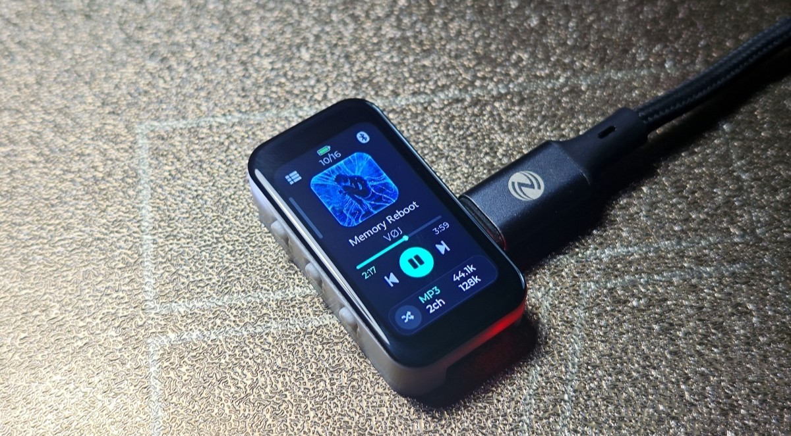</p>
<p align="center"><sub>图 1　music_nano，22 × 42 × 8 mm(不含电池)</sub></p>

<p align="center">复刻成本 <b>≈ ¥50</b>　·　固件 <b>MIT</b>　·　硬件 <b>GPL-3.0</b></p>

## 文档信息

|  |  |
| --- | --- |
| 作者 | coconut |
| 建立 | 2026-09 |
| 更新 | 2026-11 |
| 固件版本 | 0.8.1 |
| 源码 | [github.com/coconut-E/music_nano](https://github.com/coconut-E/music_nano) |
| 硬件工程 | [oshwhub.com/coconet/project_bxhxmpkd](https://oshwhub.com/coconet/project_bxhxmpkd) |
| 在线烧录 | [coconute.dpdns.org/flash](https://coconute.dpdns.org/flash/) |
| 演示视频 | [哔哩哔哩 BV1nEtp6qE72](https://www.bilibili.com/video/BV1nEtp6qE72) |

## 目录

| | | |
| :--- | :--- | :--- |
| **01** | 介绍 | [1.1 概述](#11-概述) |
| **02** | 设计 | [2.1 外观](#21-外观) · [2.2 电路](#22-电路) · [2.3 软件设计](#23-软件设计) |
| **03** | 复刻 | [3.1 物料](#31-物料) · [3.2 打样与焊接](#32-打样与焊接) · [3.3 烧录](#33-烧录) |
| **04** | 更新 | 版本时间线 |
| **05** | 链接 | 文档索引 |

---

## 01 / 介绍

### 1.1 概述

music_nano 是一台拇指大小的蓝牙音乐播放器，22 × 42 × 8 mm，可以塞进任何口袋。
MicroSD 卡里的 MP3 / FLAC / WAV 由 ESP32 直接解码，经**蓝牙 Classic A2DP** 推给耳机或音箱；
1.47 寸屏上用 LVGL 做界面，顺带能看歌词、读小说。

- **没有喇叭，也没有耳机孔** —— 声音只走蓝牙。
- **电池是滑块式的** —— 像推卡片一样插进取，带一块听一块，没电就换
- **OTA 双槽** —— 网上升级，新固件跑不起来会自动退回旧槽

| 项目 | 规格 |
| --- | --- |
| 主控 | ESP32-D0WDR2-V3 · 双核 240 MHz · 片内 2 MB PSRAM · 外挂 8 MB Flash |
| 屏幕 | 1.47" IPS · 172 × 320 · JD9853（SPI） |
| 触摸 | CST816（I²C，中断触发） |
| 音频 | 蓝牙 Classic A2DP 输出 · AVRCP 控制 |
| 解码 | MP3 / FLAC / WAV · 最高 48 kHz / 16 bit / 320 kbps |
| 存储 | MicroSD（卡座带插入检测，单文件索引） |
| 无线 | 蓝牙 4.2 Classic · WiFi 2.4 GHz（只给 OTA 用） |
| 电池 | 弹片触点，滑块式可插拔，整机不带固定电池 |
| 尺寸 | 22 × 42 × 8 mm（不含电池） |
| 功耗 | 播放 0.3 ~ 1.0 W · 深睡 ≈ 3 mW |

## 02 / 设计

### 2.1 外观

全面屏，长方形机身，四角圆角过渡，右侧边框留出三颗按键的位置。
Type-C 和 MicroSD 卡槽开在同一侧，背面是可推拉的电池仓盖。

<p align="center">
  
  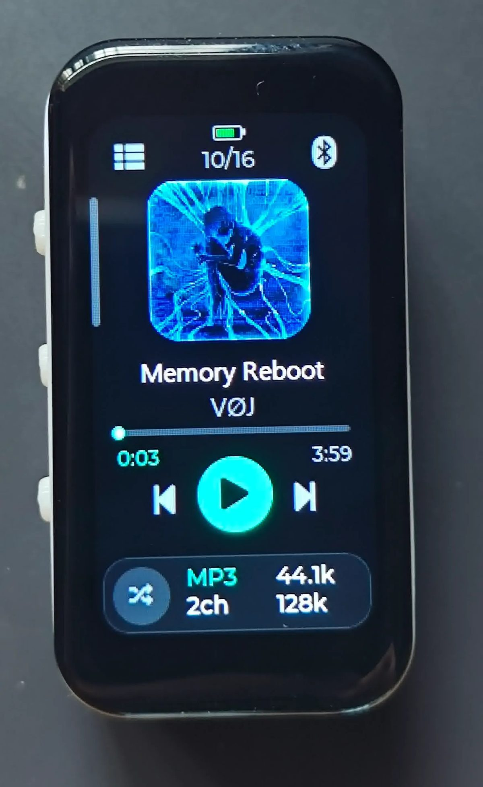
  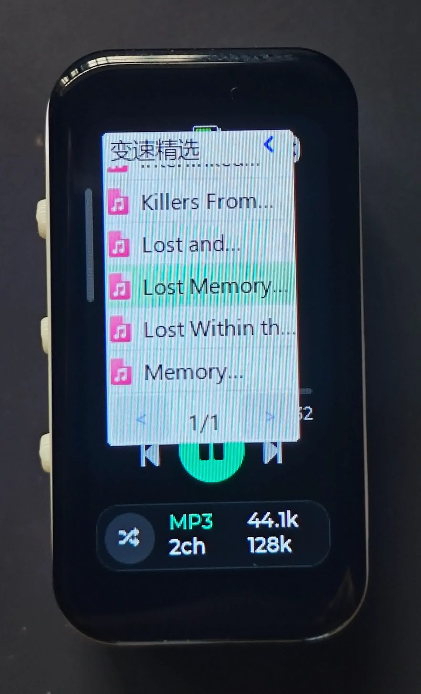
  
</p>
<p align="center"><sub>图 2　正面外观与四种界面：蓝牙面板 / 播放页 / 歌曲列表 / 已连设备</sub></p>

电池像推卡片一样滑进电池仓，靠弹片触点接触，不需要焊接也不需要插头：

<p align="center">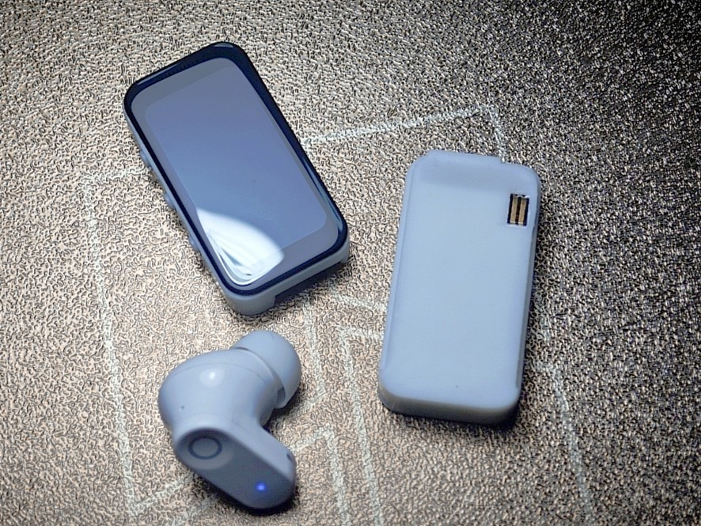</p>
<p align="center"><sub>图 3　整机与一只 TWS 耳机，体积参照</sub></p>

外壳是三个独立件：

<p align="center">
  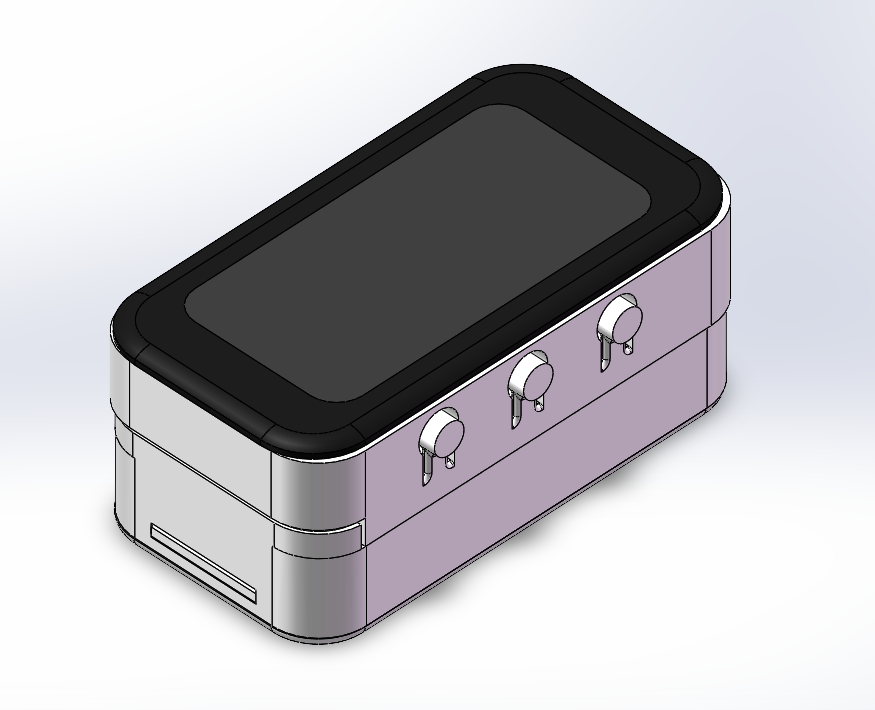
  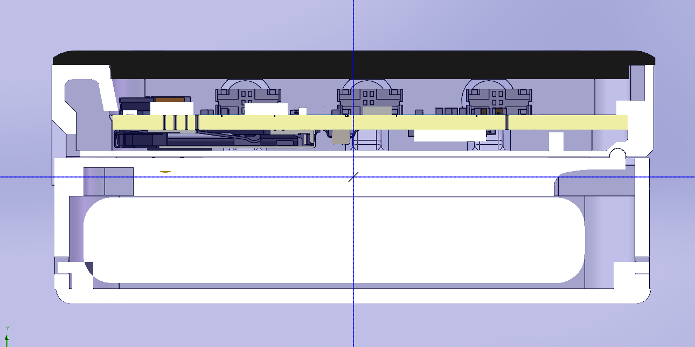
</p>
<p align="center"><sub>图 4　左：外壳装配体；右：剖面，自上而下是屏幕、主板、电池</sub></p>

<p align="center">
  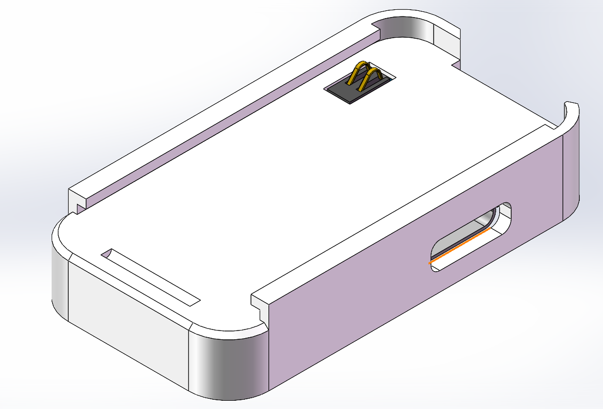
  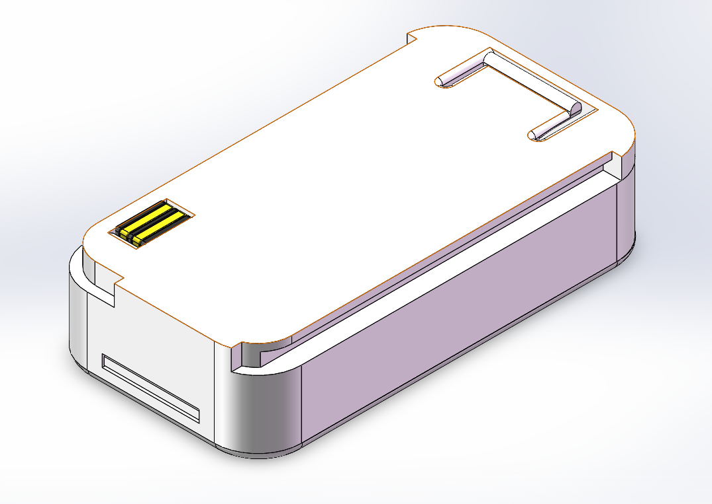
</p>
<p align="center"><sub>图 5　电池仓盖与内侧弹片触点</sub></p>

### 2.2 电路

#### 2.2.1 总体架构

一块板解决全部问题：ESP32 做解码和界面，蓝牙把 PCM 推出去，USB 只用来供电和烧录。
整页原理图如下，工程文件在立创开源硬件平台。

<p align="center">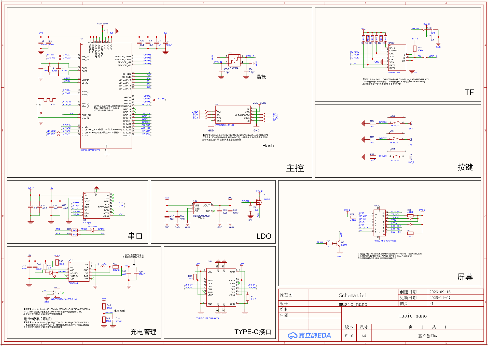</p>
<p align="center"><sub>图 6　原理图全图（V1.0，2026-11-07 更新）</sub></p>

主板装在壳里的样子：

<p align="center">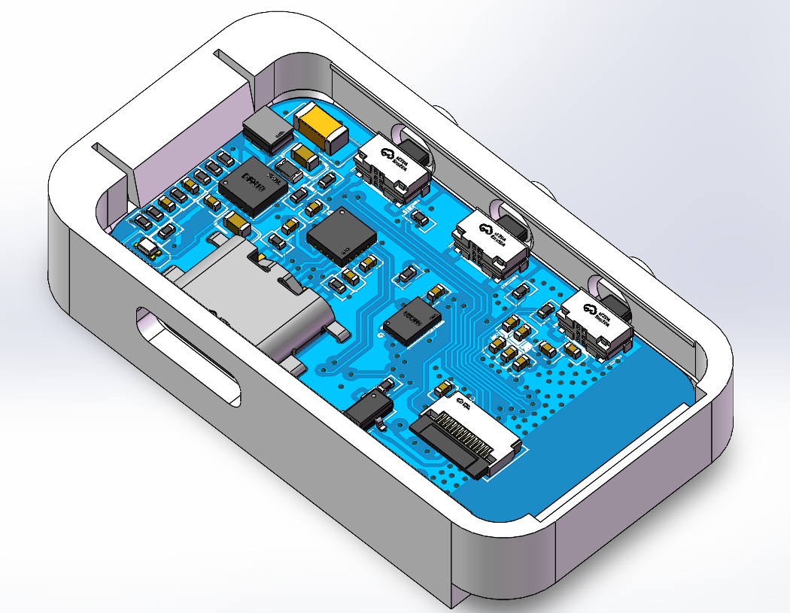</p>
<p align="center"><sub>图 7　主板放进外壳，右侧三颗按键贴着侧边</sub></p>

#### 2.2.2 主控

ESP32-D0WDR2-V3，QFN-48 封装，片内 2 MB PSRAM，外挂一颗 **P25Q64SH**（8 MB SPI Flash）。
40 MHz 无源晶振，板载 PCB 天线，EN 由 CH343P 的 RTS 经 1 kΩ 驱动做自动复位，
GPIO0 走 DTR，构成常见的两线自动下载电路。

固件与硬件的引脚对应关系如下，左边是原理图里的网络名：

| 功能 | 原理图网络 | 封装引脚 | GPIO | 固件宏 |
| --- | --- | :---: | :---: | --- |
| 屏 SPI 时钟 | `LCD_CLK` | 35 | 18 | `PIN_LCD_SCLK` |
| 屏 SPI 数据 | `LCD_SDA` | 36 | 23 | `PIN_LCD_MOSI` |
| 屏 片选 | `LCD_CS` | 34 | 5 | `PIN_LCD_CS` |
| 屏 复位 | `LCD_RST` | 14 | 25 | `PIN_LCD_RST_HW` |
| 屏 数据/命令 | `LCD_RS` | 12 | 32 | `PIN_LCD_DC` |
| 背光 PWM | `LEDK` → Q3 | 24 | 4 | `PIN_LCD_BL` |
| 触摸 SCL | `TP_SCL` | 16 | 27 | `TOUCH_SCL_IO` |
| 触摸 SDA | `TP_SDA` | 15 | 26 | `TOUCH_SDA_IO` |
| 触摸 INT | `TP_INT` | 13 | 33 | `TOUCH_INT_IO` |
| 音量 + | `SW3` | 5 | 36 | `PIN_VOL_UP` |
| 电源键 | `SW4` | 6 | 37 | `PIN_PWR_KEY` |
| 音量 − | `SW5` | 7 | 38 | `PIN_VOL_DOWN` |
| 外设断电 | `GPIO22` → Q1 | 39 | 22 | `PIN_PWR_CUT` |
| SD 插入检测 | `CD` | 20 | 13 | `PIN_SD_DETECT` |
| 电池电压 | 分压节点 | 11 | 35 | ADC1_CH7 |

#### 2.2.3 电源与充电

两路电源，各自负责一件事：

- **3V7**：USB 5V 进来先过 SLM6305（开关充电 + 路径管理），4.7 µH 电感、150 mΩ 采样电阻，
  同时接电池弹片。电池满电 4.2 V，走 3V7 这一路。
- **3V3**：ME6217C33M5G（800 mA LDO）把 3V7 降到 3.3 V，给主控供电。
- **3V3_2**：Q1（AO3401 P-MOS）受 GPIO22 控制，是外设总闸。深睡前拉高 GPIO22 断开这一路，
  把屏、卡、触摸一起断电，只剩主控，静态功耗降到毫瓦级。

电池电压用 20 kΩ / 10 kΩ 分压进 GPIO35，100 nF 滤一下，软件查表换算成电压和百分比；
充电状态由 GPIO39 读 SLM6305 的 `NCHRG`。

#### 2.2.4 屏幕与触摸

屏幕和触摸用一个 15 针 FPC（0.3 mm 间距）

- 屏：JD9853，172 × 320，4 线 SPI 写命令和像素，背光走 GPIO4 的 PWM
  （Q3 三极管低边驱动），复位脉冲由 bootloader 钩子在开机最早期打完
- 触摸：CST816，I²C 地址 0x15，INT 接 GPIO33 做下降沿中断，软件不用轮询

#### 2.2.5 存储与按键

- MicroSD 走 1 线 SDIO，卡座 503398-1892，`CD` 脚接 GPIO13 做插入检测（高 = 未插入）
- 三颗 TS24CA 轻触开关接 GPIO36 / 37 / 38，各带 10 kΩ 下拉，按下为高电平

固件里这三个键分工如下：

| 键 | 音乐模式 | 小说模式 | 设置页 |
| --- | --- | --- | --- |
| 音量 +（36） | 音量 +1 档 | 亮度 +8 | 忽略 |
| 音量 −（38） | 音量 −1 档 | 亮度 −8 | 忽略 |
| 电源（37） | 短按息屏/亮屏，长按 0.8 s 进主菜单 | 同左 | 同左 |

音量键 10 ms 轮询一次，点一下走一档；按住超过 600 ms 后每 150 ms 连发，调大范围不用一直点。

#### 2.2.6 USB

Type-C 16P 母座，CC1 / CC2 各 5.1 kΩ 下拉，只认 5 V 输入。
USB 的 D+ / D- 只接到 CH343P，不进 ESP32 —— 它只是串口，不是 USB 设备。
DTR / RTS 两根控制线经 1 kΩ 分别驱动 GPIO0 和 EN，一根线就能烧录。

#### 2.2.7 PCB

板子外形就是外壳内腔的形状，一头圆角大、一头收窄：MicroSD 卡座和 Type-C 开在同一侧边缘，
屏 FPC 座在对侧，天线留净空区。

<p align="center">
  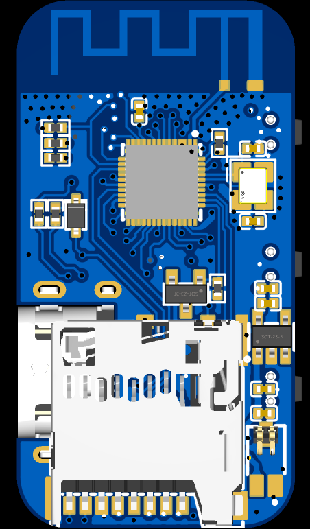
  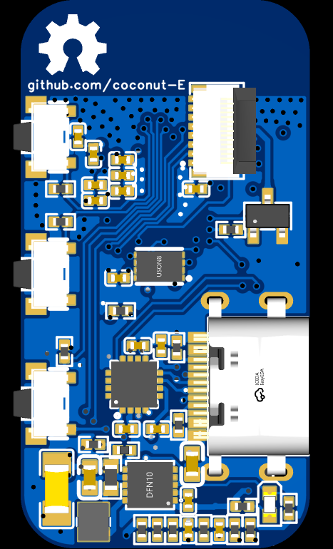
</p>
<p align="center"><sub>图 8　PCB 3D：顶层（左）与底层（右），丝印上留了仓库地址</sub></p>

<p align="center">
  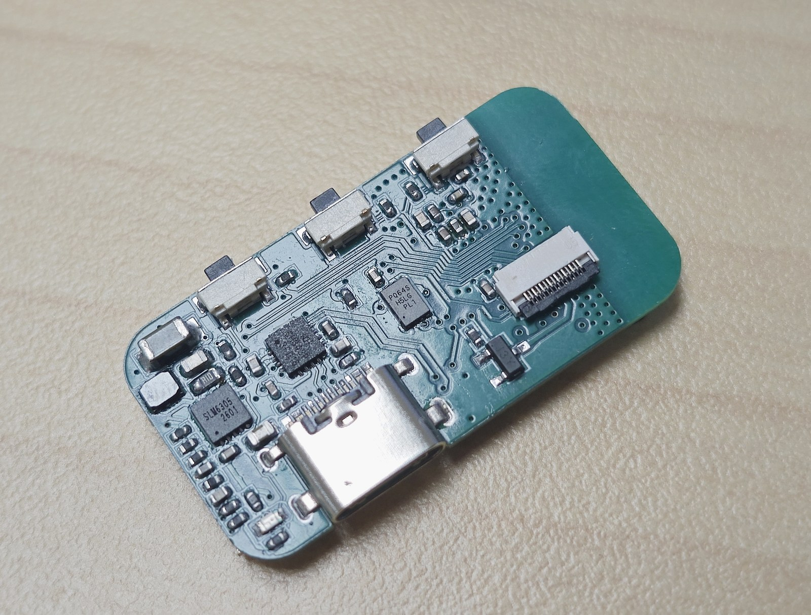
  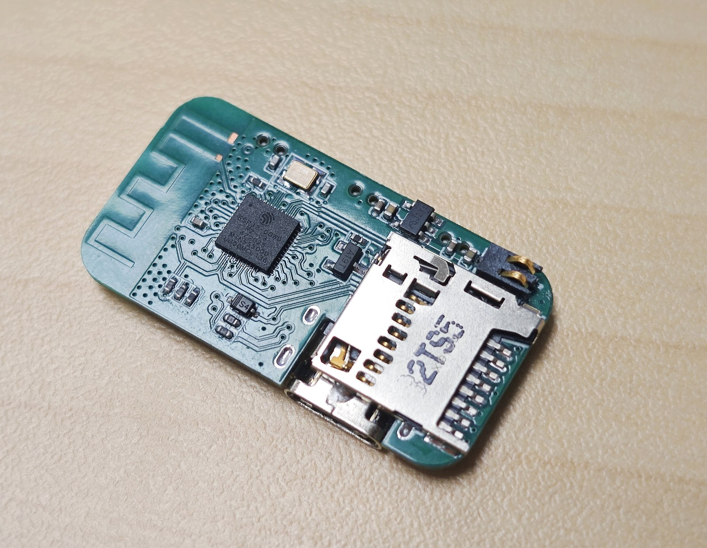
</p>
<p align="center"><sub>图 9　实物：正面是按键与屏座，背面是 ESP32、TF 卡座和 Type-C</sub></p>

### 2.3 软件设计

固件基于 ESP-IDF 5.5.5 + FreeRTOS + LVGL 8.3。解码和蓝牙在 core 0，界面、扫描、封面在 core 1；
但两者不是一条单向流水线——界面下发命令，解码回传状态，耳机上的按键绕一圈又驱动界面：

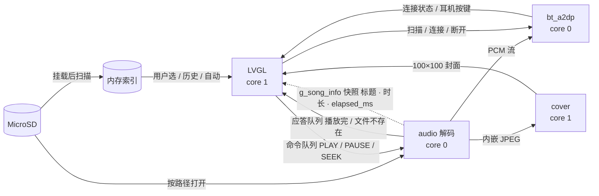

| 任务 | 核 | 栈 | 职责 |
| --- | :---: | ---: | --- |
| `audio` | 0 | 4 KB | 打开文件、解码、重采样、推流 |
| `bt_a2dp` | 0 | 4 KB | A2DP / AVRCP、设备扫描与连接 |
| `lvgl` | 1 | 6 KB | 界面、触摸、歌词滚动 |
| `cover` | 1 | PSRAM | 把内嵌 JPEG 在 RAM 里解成 100×100 |
| `sys_monitor` | 1 | 5 KB | SD 挂载与扫描、电池电压、CPU 温度 |
| `sys_serial` | 1 | 3 KB | 串口控制台 |
| `wifi` | 1 | — | 只在升级时创建，用完销毁 |

任务之间只有四种通道：

- **命令队列**（UI → 解码）：`PLAY` 带文件路径、`PAUSE`、`SEEK`（千分比，不是字节偏移）、
  `BT_CONNECTED` / `BT_DISCONNECTED`
- **应答队列**（解码 → UI）：`SONG_FINISHED`、`FILE_NOT_FOUND`、`BT_CHECK`
- **全局快照**（解码 → UI）：`g_song_info` 里有标题、格式、采样率、总时长和 `elapsed_ms`，
  还带一个 `path_hash` 让界面认领"这是哪首歌"；`song_info_snapshot()` 一次拷贝防撕裂
- **事件队列**（蓝牙和界面之间双向）：搜索到设备、连接、断开、耳机上的播放暂停与上下曲；
  断开时界面再给解码补一条 `BT_DISCONNECTED` 停推

core 0 那条链要连续喂数据，慢一拍耳机就断音；core 1 上卡一下只是掉帧。所以界面再忙也不会
把解码饿着，反过来也不会有解码抢走了 CPU 导致界面卡死这一说。

**启动流程**（`main.c`）

`app_main()` 里是一条直线，各任务由对应的 `*_init()` 在内部创建：

1. **bootloader**：拉外设电源、放 LCD 复位脉冲，见 2.2 那个钩子
2. **`power_mgr_early_init()` + `lcd_init_early()`**：外设上电、SPI 总线、面板 SLPOUT，只做前半段，
   剩下的 120 ms 留给后面几步去填
3. **`power_batt_boot_check()`**：ADC 三次采样求平均，低于 3.35 V 就显示低电量图两秒后深睡，不再往下走
4. **`nvs_flash_init()` → `font_part_init()`**：字库分区 mmap 进 DROM，必须早于任何文字绘制
5. **`app_mode_read_saved()`**：只认音乐 / 小说，决定这次建哪一组界面
6. **三个队列**：app 10 / audio 10 / rsp 5
7. **六个 `*_init()`**：见下表，每个都顺手建一个任务
8. **上次停在小说模式**：音频 / 封面 / 蓝牙任务先挂起，把 core 1 让出来
9. **`ota_init()`**：刚升级上来的固件开 15 秒校验窗口，走完才 `mark_valid`
10. **`vTaskSuspend(NULL)`**：入口任务退场，之后只剩各任务在跑

| init | 起的任务 | 起来后先干什么 |
| --- | --- | --- |
| `bt_a2dp_init()` | `bt_a2dp`（core 0） | 按控制器 → Bluedroid host → profile 三段把栈拉起来，然后等命令 |
| `console_init()` | `sys_serial`（core 1） | 读 UART，解析成 app 命令投进队列 |
| `ui_core_init()` | `lvgl`（core 1） | 恢复音量/亮度 → 显示与触摸 → 建界面 → 队列集 → `lcd_init_finish()` |
| `audio_task_init()` | `audio`（core 0） | 建解码器和重采样，然后阻塞在命令队列上 |
| `sys_monitor_init()` | `sys_monitor`（core 1） | 等 150 ms，读 SD 检测脚，卡已插就挂载并扫描 |
| `cover_init()` | `cover`（core 1，栈在 PSRAM） | 等解码器把内嵌 JPEG 递过来 |

`lvgl` 任务的开场在 `ui_loop.c` 里，顺序有讲究：`ui_core_display_init()` → `ui_shell_init()` →
`bt_list_init()` → `app_mode_init()`（按启动模式只建一组界面）→ 创建队列集 → `lcd_init_finish()`
（这时距 SLPOUT 正好过了 120 ms）→ 先跑一帧 → `autosleep_init()` → `power_mgr_init()`（背光渐入）。
文件浏览器不在启动时一次建完，改成主循环里每轮最多 10 ms 分片建，卡顿被 300 ms 的背光渐入盖住。

**模式切换**（`app_mode.c`）

所有切换都从 `app_mode_request()` 进：同一模式直接返回，切换中防重入。真正的切换发生在
`power_mgr_mode_transition()` 给的过渡窗口里——先关触摸，能跑光圈动画就跑，跑不动就淡背光到黑再切。

| 模式 | 退出时 | 进入时 |
| --- | --- | --- |
| 音乐 | 停播 → 等解码器放开 SD（最多 300 ms）→ 挂起音频/封面/蓝牙 → 销毁播放器界面 | 恢复三个任务 → 切回音乐库 → 重建界面 → 载入上次那首（不自动播） |
| 小说 | 只销毁阅读界面 | 切到小说库 → 建阅读界面 |
| 设置 | 只删页面，它不持有音频资源 | 白底列表 |
| 菜单 | 删菜单 | 建三图标 |

两个细节：

- **只有音乐和小说写 NVS**。停在菜单时断电，下次开机仍然回到上一首所在的模式
- **过渡方式分两种**：涉及设置页就只淡背光。设置页是整屏大白底，黑白交界最长，任何带写入都会在
  交界处留一道亮度台阶，看起来像"一根灰线在 Y 上乱跳"；菜单/音乐/小说底色本来就是黑的，
  接缝看不出来，就走光圈缩放

**SD 卡只有三处会碰，全都过同一把锁**

- **音乐界面一次盘都不读**：列表、封面、歌词全走内存索引 `g_fs_cache`；封面由 `audio` 从解码器里
  取出内嵌 JPEG 交给 `cover` 任务，后者用 `JPEG_openRAM()` 在内存里解，也不碰 SD
- 真正读盘的是三处：`sys_monitor`（扫描 / 挂载 / 卸载）、`audio`（`fopen` / `fread` / `fseek` / `fclose`）、
  以及**小说阅读器**——它是唯一在 UI 线程里读盘的例外，翻页时持锁读 1 KB
- 拔卡是一条确定的时序：`g_sd_ready = false` 让解码器自己关文件 → 每 10 ms 试锁确认没有在途
  FATFS 调用（最多等 3 s）→ 拿到锁才 `esp_vfs_fat_sdcard_unmount()`，否则会触发卷锁断言
- 扫描完**不**立刻回读索引文件：刚写完马上读会偶发校验失败（音乐/小说只坏一个），直接用内存那份

四处值得一看的地方，注释里都写了"为什么"：

- **开机在 bootloader 里就把屏点亮** —— `bootloader_components/lcd_boot_hooks/` 编进 bootloader，
  直接用寄存器拉外设电源、打复位脉冲，省掉 app 起来后再等 120 ms 的 LCD 稳定时间；
  顺带清掉 RTC 域的 pad hold，否则从深睡唤醒会黑屏
- **下载时把屏的绘制缓冲借给 WiFi** —— WiFi 起来要 ~27 KB 内部 RAM，`wifi_arena.c` 把 LVGL
  让出的那块静态缓冲用 `multi_heap_register()` 注册成 WiFi 私有堆，换掉 `wifi_osi_funcs_t`
  里的分配函数，下载完再整块还回 LVGL
- **睡眠是一条只能往下走的梯子** —— 息屏 / 浅睡 / 深睡收敛成 4 个事件 + 一张十几行的决策表，
  "要不要看蓝牙、要不要浅睡"全工程只有这一处判断
- **全整数定点** —— ESP32 没有 FPU，解码与重采样都是纯整数实现，整套流程大约 15% CPU

Flash 分区（8 MB，OTA 双槽）：

```
nvs       0x009000  144 KB
phy_init  0x02D000    4 KB
otadata   0x02E000    8 KB
ota_0     0x030000  2.875 MB   app 槽
ota_1     0x310000  2.875 MB   app 槽
font      0x5F0000  2.0625 MB  字库（只在线烧写时写入）
```

小分区终点正好落在 `0x30000`，对齐空洞为 0，8 MB 一字节不剩。

## 03 / 复刻

### 3.1 物料

BOM、坐标文件、原理图与 PCB 都在立创工程里
**[oshwhub.com/coconet/project_bxhxmpkd](https://oshwhub.com/coconet/project_bxhxmpkd)**，复刻成本约 ¥50。

除板子外还需要：1.47 寸 172×320 的 JD9853 屏（带 CST816 触摸，15P FPC）、
P25Q64SH 或同容量 SPI Flash、滑块电池与外壳（三个 STEP 文件）、
电池充电弹片座（1.27 mm 2P）和对应的公座（2.95H）。

### 3.2 打样与焊接

嘉立创打样：4 层板，厚 1 mm。
焊电池充电弹片的公座时位置要对准，偏了会让电池接触不良。

### 3.3 烧录

| 方式 | 适用场景 | 怎么做 |
| --- | --- | --- |
| 网页一键烧录 | 第一次玩，不想装环境 | 打开[在线烧录](https://coconute.dpdns.org/flash/)，Chrome / Edge 加一根 USB 线，约 12 分钟 |
| 线烧全量 | 换分区表、芯片全空 | `tools\flash_step.ps1 once` |
| 本地构建 | 想改代码 | ESP-IDF 5.5.5，`idf.py build` |

需要 **ESP-IDF 5.5.5**，必须这个版本：WiFi 协议栈是随 IDF 发布的预编译库，
表布局与版本绑定，本工程还整表替换了分配器并 `--wrap=free`。

仓库里另有 `build.ps1`（过滤噪声的构建包装）与 `mem-analyze.ps1`（ELF 内存占用分析），详见 [BUILD.md](BUILD.md)。

## 04 / 更新

| 时间 | 版本 | 内容 |
| --- | --- | --- |
| 2026.09 | 0.1 | 蓝牙 A2DP 出声，屏幕点亮，三任务架构 |
| 2026.09 | 0.4 | MP3 / FLAC 解码，文件浏览器，封面 |
| 2026.09 末 | 0.6 | 三图标主菜单、设置页、小说阅读 |
| 2026.10 | 0.7.3 ~ 0.7.9 | 歌词、字库分区、OTA 双槽、WiFi 升级 |
| 2026.11 | 0.7.12 ~ 0.7.14 | 自动休眠、自动熄屏、浅睡三级梯 |
| 2026.11 | 0.8.x | 自建 OTA 服务器，10 块压缩下载 |

逐版本的详细记录（改了什么、为什么这么改、踩了哪些坑）在 **[docs/CHANGELOG_zh.md](docs/CHANGELOG_zh.md)**。

## 05 / 链接

| 资料 | 说明 |
| --- | --- |
| [docs/CHANGELOG_zh.md](docs/CHANGELOG_zh.md) | 逐版本开发记录 |
| [docs/OTA_TEST_zh.md](docs/OTA_TEST_zh.md) | OTA 协议、实测数据与踩过的坑 |
| [BUILD.md](BUILD.md) | 构建脚本与内存分析 |
| [docs/STATS_zh.md](docs/STATS_zh.md) | 代码量统计 |
| [THIRD_PARTY.md](THIRD_PARTY.md) | 第三方组件与各自许可证 |
| [ESP-IDF](https://github.com/espressif/esp-idf) | 5.5.5 |
| [LVGL](https://github.com/lvgl/lvgl) | 8.3 |
| [立创开源工程](https://oshwhub.com/coconet/project_bxhxmpkd) | 原理图 / PCB / BOM / STEP |

---

<div align="center"><sub>

**软件** MIT © coconut-E 　·　 **硬件**（立创工程）GPL-3.0

</sub></div>
