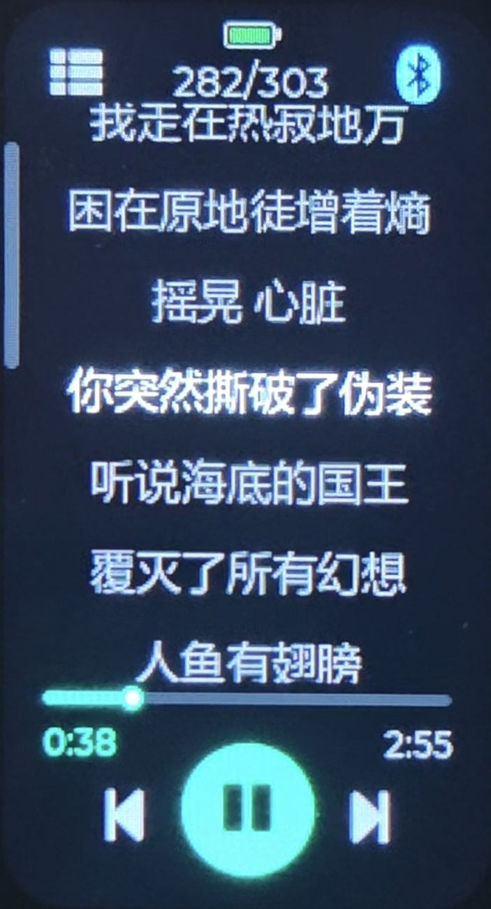
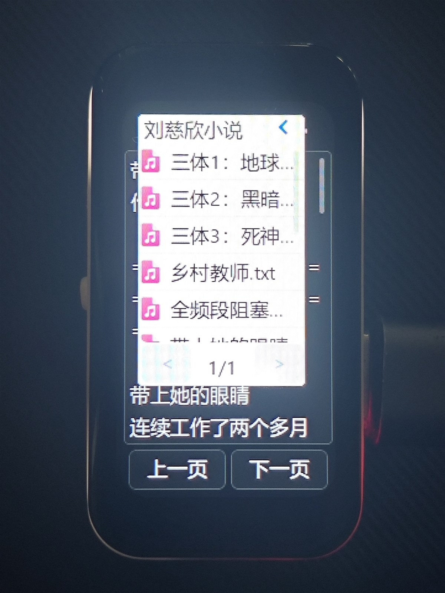
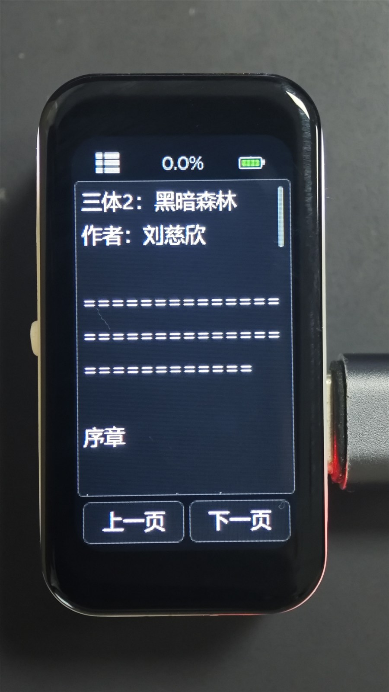
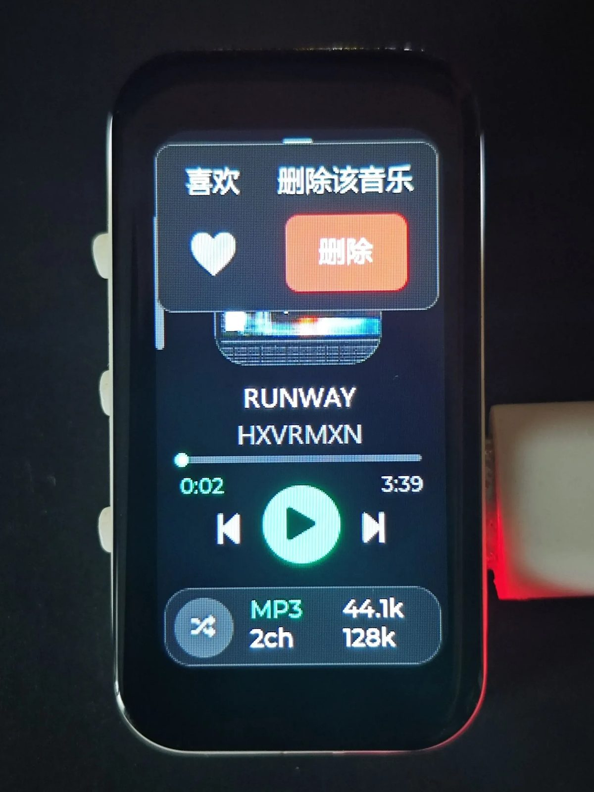
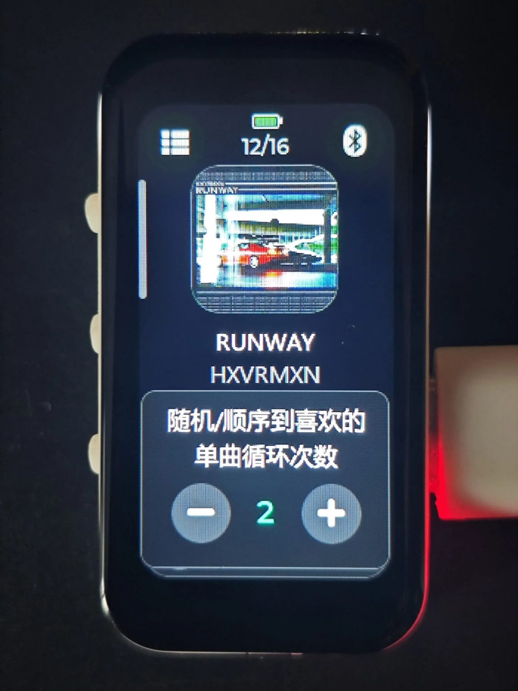
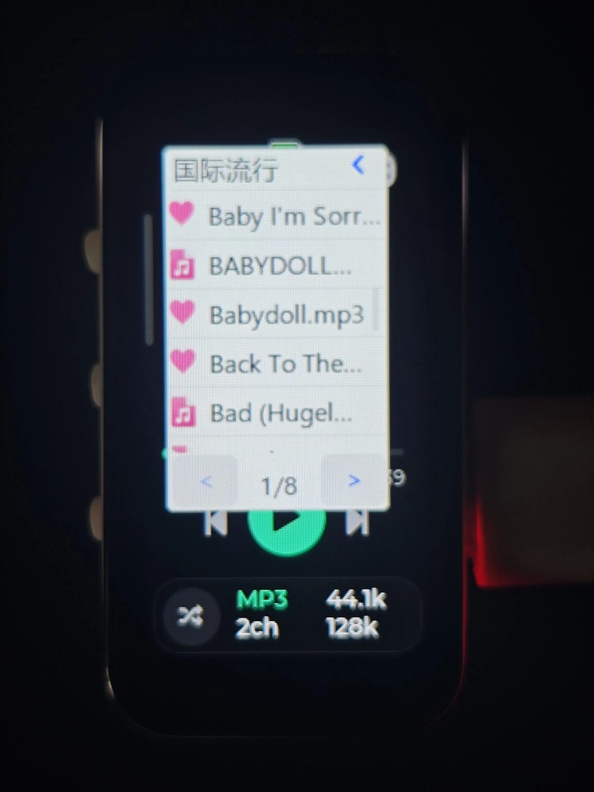

# 更新日志

> 从 README 拆出来的逐版本记录：改了什么、为什么这么改、踩了哪些坑。
> 新的写在最前面，固件版本号见 `version.txt`。

### 2026.11.14

**自动熄屏（0.7.15）**
- 设置页第三项「自动熄屏」：**通用 / 小说 / 歌词** 三条分支，各 **1~10 分钟**，存 NVS（`off_common` / `off_novel` / `off_lyr`）
- "通用 + 特殊"两层次：通用兜住菜单、设置、音乐封面**以及以后新加的任何模式**；小说和歌词只是两条覆盖 —— `idle_poll_cb` 里只列举两条特殊分支，其余默认走通用，加新模式不用再动那个 if
- 菜单和设置原来固定 30 秒，并进通用分支后最短一档就是 1 分钟（默认 2 分钟），这是"通用"带来的必然变化
- 时长缓存在 RAM（开机从 NVS 灌一次），1 秒轮询不碰 flash；保存后立刻生效，不用重启
- 数值弹层去掉半透明黑背景：只留一张白卡，点卡片外仍然关闭 —— 遮罩对象还在，只是 `bg_opa = LV_OPA_TRANSP`，白底设置页不再整页压暗

**下拉弹层（0.7.14 的自动休眠同款）**
- 小时/分钟/三条熄屏分支共用一个通用下拉：`pick_open(id, sel, base, step, count, fmt)`，候选项由 `base + i*step` 生成，行高在 7 项以上收到 26px（10 项才能塞进 320 的高度）

**浅睡（0.7.16）**
- 电源键短按（蓝牙断开）/ 无操作超时 / 息屏期蓝牙断开：**背光正常淡出** → **浅睡 5 分钟** → 期间按电源键立刻淡入亮屏，程序从断点继续；5 分钟到点才走原来的深睡（GPIO22 断电）。蓝牙已连接时仍然只熄屏，不睡 —— 浅睡会掐断 A2DP 流
- 浅睡不关外设电源：GPIO22 全程保持低，只停 CPU/AHB/APB 时钟（`esp_light_sleep_start()` + ext0(GPIO37 高) + 5 分钟 timer）
- 上机实测（当时的 `lsp` 自检命令，已随睡眠路径统一删除）：PSRAM 1KB / 内部 RAM 256B 内容全保（靠 `CONFIG_ESP_SLEEP_PSRAM_LEAKAGE_WORKAROUND` + `CONFIG_PM_SLP_SPIRAM_HALFSLEEP_ENABLED`，IDF 醒来调 `esp_psram_impl_resume_from_halfsleep_mode`）；整屏重绘无花屏；触摸 I2C 正常；SD 仍挂载、`stat("/sdcard")=0`；音乐在浅睡前后继续播
- **`esp_timer +10000 ms` 而 `FreeRTOS tick +1 ms`**：IDF 只把系统时间补上来，不补 tick。所以醒来必须自己处理两处计时 —— 无操作计时靠 `power_mgr_notify_activity()`（`pwr_wake()` 里已有），自动休眠靠 `autosleep_on_wake()` 把结算基准挪到"现在"，浅睡那段不扣剩余量
- 两个坑：ext0 唤醒后 GPIO37 停在 RTC IO，必须 `gpio_config()` 复原成普通输入，否则电源键从此读不到；深睡前要 `esp_sleep_disable_wakeup_source(ALL)`，否则浅睡留下的 5 分钟 timer 会让深睡 5 分钟后自己醒来

**浅睡时长可调（0.7.17）**
- 设置页第四项「浅睡时长」：**0~10 分钟**，存 NVS（`ls_min`）。**0 = 不浅睡、直接深睡**（浅睡之前的老行为），1~10 = 正常淡出后先浅睡 N 分钟再深睡
- 只影响三条入口（短按且蓝牙断开 / 无操作超时 / 息屏期蓝牙断开）；自动休眠到点、低电量关机仍然直接深睡
- 时长缓存在 `power_mgr`（开机从 NVS 灌一次，睡眠路径不碰 flash），保存后下一次进睡就用新值，不用重启

**睡眠路径统一**
- 息屏 / 浅睡 / 深睡不再是三条并列分支，改成**一条三级梯**：一级 `pwr_off()` 灭屏（背光淡出 + 关触摸 + 刷新降到 100s）→ 二级 `pwr_light_sleep()` 浅睡（CPU 停钟、外设照供电）→ 三级 `power_mgr_shutdown_now()` 深睡（GPIO22 断电）。只能顺着往下走，不存在"从深睡跳回息屏"
- 所有触发方式收敛成 4 个事件（`PWR_EV_KEY` / `IDLE` / `BT_LOST` / `TIMER`）+ **一张决策表** `pwr_decide()`（20 行）：抑制、过渡、已在下电三行闸门之后，每种事件该干什么一眼看完。"要不要看蓝牙""要不要浅睡"只有这一处判断，以后加触发方式 = 加一个事件
- 状态 4 → 3（亮屏 / 灭屏 / 下电中）：`PWR_FAKE_OFF`、`PWR_LIGHT_SLEEP` 两个"淡出中"临时态删掉，凡是 `== FAKE_OFF || == LIGHT_SLEEP` 的双重判断一并消失；`s_state` 写入点 12 → 4（都在梯子的执行体里）
- 每次决策打一行日志：`事件 KEY | 状态 亮屏 | BT 断开 → SLEEP`，串口直接看得出是谁让它睡的
- 拆出两个模块：`power/power_fade.c`（全工程唯一的背光淡入淡出，6ms 一步；`lv_anim` 版 `screen_fade` 删掉）、`power/power_batt.c`（电池 ADC + 开机低压 + 紧急关机）。`power_mgr.c` 992 → 666 行，只剩"什么时候睡、怎么睡"
- 删掉三个 `lv_anim` 形状的空壳回调（`sleep_entry` / `sleep_fade_done` / `enter_deep_sleep` / `enter_light_sleep`）和手工传 `NULL` 的调用；无操作超时与蓝牙断开两个 1 秒定时器合并成一个看门 `pwr_watch_cb`
- 两处行为修正：① 息屏期蓝牙断开现在也受 OTA/WiFi 抑制约束（原来 `bt_poll_cb → sleep_entry()` 完全绕过抑制，升级窗口里蓝牙一断就照睡）；② 自动休眠到点仍然直接深睡、不走浅睡这一级（保留"到点就关机"，也避免"刚被叫醒又立刻睡"的连锁）
- 删掉调试代码：`lsp` 浅睡自检（Phase 0，95 行）、`flashspd` flash 擦写测速探针（197 行，会写非运行槽）；`console.c` 855 → 631 行。保留 `sleep <秒>`（现在唯一能现场验证自动休眠链路的钩子，且已走统一事件）

**歌词页改窗口渲染（0.7.18）**
- 现场症状：`匿名M`（206 行歌词）播到第 12 块、约 **00:14** 之后歌词区整片空白（连当前句的高亮都没了），但滚动动画照旧；库里其它歌都正常 —— 最大的《Dusk Till Dawn》152 行 / 76 块也没事
- 根因是渲染方式，不是数据：旧实现把整篇歌词做成一个 `s_content` 内容层（这首歌 `total = 8672 px` 高），9 个 label 摆**绝对坐标**（最大 8672），再对这个内容层做**负的 y 平移**（一路到 −8558）。`LV_USE_LARGE_COORD 0` 下 `lv_coord_t` 是 int16，坐标量级已经逼近边界；再叠上"每 100 ms 把 9 个 label 的位置和文本重设一遍"，长歌词滚到中途就整片失效。歌词越短越到不了那个量级，所以只有这首触发
- 现在 label **直接挂 172×204 的歌词容器**，没有中间内容层：位置 = 半高基准 + `(s_y[e] − s_y[cur])` + 一个滚动偏移 `s_off`。差值最大只到"前后各 4 块的高度和"（几百 px），与歌词总长无关；滚动 = 对 `s_off` 做 250 ms `lv_anim`，每帧只重摆这 9 个 label
- 稳态优化：块没换的 tick 直接返回，不再每 100 ms 重设 9 份文本和坐标；换块时把上一帧的动画残余量接着算，切换那一帧不跳
- `LYRICS_MAX_ENTRIES` **192 → 256**：这首歌 206 行，原来尾部 14 行（`[02:23.46]` 之后）是静默丢掉的；现在撞上限会打一行 `[歌词] 条目 N 达到上限 256, 超出的行已丢弃`
- 加了自检：有歌词却一个可见 label 都没有时打 `[歌词] 窗口全空 cur= count= y= off=`. 万一还有别的原因复现，这一行直接把 `s_cur`/`s_count`/坐标摆到面前，不用再靠猜

**歌词：中日同一行拆成两行（0.7.19）**
- 现象：有些 LRC 把原文和译文写进**同一条**（`[00:21.57]感じて 今夜は見事さ 用心感受的今夜 旖旎非常`），一个时间戳里混着两种语言，显示成 3~4 行糊在一起的一整段
- 根因：`script_of()` 把汉字和假名归成同一类（`script_class()` 返回 100，日文才不会被切碎），于是**中文和日文在分类器眼里是同一个体系**，`split_scripts()` 永远切不开
- 新增 `find_cn_break()`：整行有假名 → 找一个空格，其后到行尾**再无假名、无 ASCII 字母**，且汉字 ≥5 个或含一个**简体专用字**（的们这说为个时对就很没什么怎让还过现记觉谢语词谁爱听话读样种从关带开务边达进远那吗呢啦啊哦嗯，日文不用这些写法）→ 就在这里断一段
- **只切不改**：正文原样保留，`ラストリヴ` 每行尾自带的 `(翻译：…)` 不剥（那是 LRC 里的文字，不是固件加的）
- `LYR_MAX_SEGS` 4 → 5（原来最多按文字体系拆 4 段，加上这一刀要留余量）
- 两个语料库实测（本地 268 首 + music4.2 129 首）：本地命中 98 行 / 3 首（NIGHT DANCER 44、Heaven 40、Episode 33 14），music4.2 命中 47 行 / 5 首；朴素版（只要"假名之后一串汉字"就切）会误切 `「ダイエット？」/不正解`、`求愛性 孤独/ドク 流るルル`、`ライフル/何口径？`、`検索中` 这些纯日文行，被"简体专用字 / 汉字≥5"两条挡下

### 2026.11.13

**自动休眠（0.7.14）**
- 设置页新增第二项「自动休眠」：小时 **0~3** / 分钟 **0~60（步进 10）**，两个下拉各列可选值；`0 小时 0 分` 没有意义，「保存」按钮直接置灰不可点
- 落盘只存一个**总分钟数**（10~240）：存小时+分钟两个字段会出现「1 小时 60 分」和「2 小时 0 分」两个等价状态，存总时长就只有一个真值，显示时再拆
- 音乐页长按播放模式按钮弹出的面板从 120 加高到 **152**：顶部左边是「自动休眠」开关，右边是深色 `lv_switch`；打开后左边文字实时变成「将在X小时Y分钟后休眠」，关闭回到「自动休眠」（原来是说明文字，整体下移给开关腾位置）
- 开关状态存 NVS（`sleep_on`），设定时长存 `sleep_min`；开机时若开关是开的，就从**开机那一刻**开始计
- **剩余时间是纯内存量，不进 NVS**：重启即从头算，用户明确要求"重启了不用管它"
- 计时只在音乐模式走：进菜单/设置/小说时**暂停但不清零**，回音乐接着走，不补扣暂停那段；息屏不算离开音乐（蓝牙还在放），照常计
- 到点走与"蓝牙未连接时短按电源键"同一条淡出→深睡路径，但**不看蓝牙**：到点就是关机（GPIO22 断电，音乐结束），不是只熄屏。OTA 校验窗口 / WiFi 流程期间照旧不睡
- 串口 `sleep` 看开关/设定/剩余，`sleep <秒>` 直接改剩余时间 —— 最短一档是 10 分钟，上机验证等不起
- 下拉是自绘弹层，没开 `LV_USE_DROPDOWN`：`lv_conf.h` 里 dropdown/roller 都是 0（开了要全量重编 LVGL），而且 LVGL 8 的下拉列表固定往下展开，分钟那档 7 项在 172×320 上必然探出屏幕

### 2026.11.8

**设置（0.7.3）**
- 菜单里的「设置」不再只是占位：点进去是**白底整屏 `lv_list`**，目前只有一项「固件版本」
- 点「固件版本」→ 详情页：当前运行 APP 的**版本号**和**镜像真实大小**（本次 `2,319,776 字节` + `2.21 MB`），左上角 `‹` 回列表
- 「检查更新」按钮先占位：**点了没有任何反应**（联网 OTA 还没做）
- 设置是第三种模式（`APP_MODE_SETTINGS`），进出走黑场过渡；**仍然不写 NVS**，长按电源键回主菜单
- 设置页 30 秒无操作自动熄屏（与菜单一致；设置里蓝牙已断开，实际是淡出后深睡）
- 大小取 running 分区里镜像的长度：**读镜像头 + 段头自己算**（`esp_image_verify()` 会把整幅镜像 mmap 进 DROM 核 SHA256，64 页 MMU 里字库已占 50 页 → 必然 `No free MMU pages`），只读一百多字节，进设置时算一次并缓存

### 2026.11.7

**主菜单（0.7.2）**
- 长按睡眠键不再直接切换音乐/小说，改为**进入主菜单**：整屏三张图标竖排（音乐 / 小说 / 设置），点图标进对应模式；设置只占位，点了无响应
- 菜单是第四种模式（`APP_MODE_MENU`），进出都走原有的黑场过渡，切出时照旧清理音频 / 封面 / 蓝牙 —— 所以进菜单 = 停止播放，和以前长按切小说一模一样
- **设置和菜单永不写入 NVS**，启动模式仍然只记音乐 / 小说；停在菜单时断电，下次开机回到上次的音乐或小说
- 菜单 30 秒无操作自动熄屏（走原有短按动作；菜单里蓝牙已断开，所以实际是淡出后深睡）
- 图标由 `tools/gen_menu_icons.py` 从 `image/` 的源图生成：裁到徽章外框 → 88×88 → 圆形 alpha 蒙版 → 合成菜单底色，三张共 46KB flash

> ⚠️ 分区表再改一次：`ota_0 @0x30000` / `ota_1 @0x280000` / `font @0x4D0000`。
> 从任何旧版升上来都必须 `tools\flash_step.ps1 once` 整片擦除重烧。

**分区**
- app 槽 2.19MB → **2.31MB**（余量 1.07% → 6.42%），nvs 88KB → **144KB**
- 吃掉两处浪费：`0x22000-0x40000` 对齐空洞 + 末尾闲置 128KB，**248KB 浪费归零**
- 字库分区 3.25MB → 3.19MB（内容 3,266,026 B，余 2.3%），地址 `0x4A0000` → `0x4D0000`

**为网络升级腾 IRAM**
- `ESP_WIFI_IRAM_OPT` / `ESP_WIFI_RX_IRAM_OPT` 关掉（IDF 对 "ESP32+蓝牙+PSRAM" 这
  个组合**本来就是默认关**，本工程是历史遗留的 `y`）
- `FREERTOS_PLACE_FUNCTIONS_INTO_FLASH=y`
- 只做 STA：`SOFTAP_SUPPORT` / `WPA3_SAE` / `SAE_PK` / `SAE_H2E` / `SOFTAP_SAE` /
  `WPA3_OWE_STA` 全关
- `LWIP_IPV6=n`；HTTP 不做 HTTPS，不带 CA 证书包
- 结果：把完整 WiFi + HTTP + OTA 栈链进来后 `.iram0.text` 118,119 B，IRAM 余
  **11.9KB**；改之前不带 WiFi 只剩 2,517 B，一加就爆 27,340 B

### 2026.11.6

> ⚠️ 本版分区表改成 **OTA 双槽**（`ota_0 @0x40000` / `ota_1 @0x270000` / `font @0x4A0000`），
> 从旧版升上来必须先整片擦除重烧一次（`tools\flash_step.ps1 once`），旧 NVS 设置会被清空。

**新增**
- OTA 双槽：新增 `otadata`，`ota_0` / `ota_1` 各 2.19MB，按 `(seq-1)%2` 选槽启动
- 首启校验窗口：新固件第一次启动时盖一层**系统层**全屏遮罩（`lv_layer_sys`）+ 15 秒倒计时，期间禁止睡眠；走完自动 `esp_ota_mark_app_valid_cancel_rollback()` 打标
- 启动失败自动回退：不做任何处理，未打标的镜像在下次重启被判 `ABORTED`，bootloader 自己退回旧槽
- 字库拆到独立 3.25MB 分区（`font`，data 子类型 `0x40`），开机 `esp_partition_mmap` 进 DROM 窗口，app 从 5,013,280 B 瘦到 1,765,136 B（槽占 23%）
- 串口命令：`version` / `ota` / `ota boot <0|1>` / `font crc`
- 烧录器：写大文件按 1MB 分段 + 末段补齐 16KB，修掉 2MB 以上单段写坏末尾几百字节的问题；新增地址白名单拦截（见"烧录与升级"）

**优化**
- 冷启动不做字库全量校验。原先在"OTA 后首启"跑一次 3.27MB CRC（271ms），但 OTA 根本不写字库分区，时机是反的；改成手动命令 `font crc`，启动路径只留纯内存校验（magic / 长度 / 偏移 / mmap / `glyph_dsc` 首末抽检）
- 同槽 `ota boot` 直接拒绝，不再写一条指向"正在运行的分区"的 otadata

**修复**
- `flash_step.ps1` 的 `$src` 与镜像源哈希表 `$SRC` 撞名（PowerShell 变量不区分大小写），不带 `-App2` 时参数解析成空
- `build.ps1` 导入 ESP-IDF 时，`export.ps1` 里 python 往 stderr 打的横幅被 `$ErrorActionPreference='Stop'` 当成致命错误

### 2026.11.1

> 本版分区表扩容到 8MB，升级需要一次性 `erase-flash`，旧 NVS 设置会被清空。

**新增**
- 歌词显示：读取 MP3 的 USLT 帧与 FLAC 的 LYRICS 内嵌歌词，按 LRC 时间轴逐行滚动、当前行高亮；封面页短按进入，点击歌词区返回，无歌词时提示
- 多语言歌词：同一时间戳（≤50ms）的原文 / 译文合并成一句，按 汉 / 日 / 韩 / 拉丁 / 西里尔 文字体系分行，作词作曲行保留显示
- 字库扩充 19,956 → 28,876 字形（2.23MB → 3.18MB）：CJK 基本区 4E00–9FFF 整段取模，简繁与日文汉字全覆盖（修掉歌词里 558 个方框字），另加希腊、拉丁 IPA、货币、圈号、箭头、数学、制表、几何等约 2,000 字
- 分区表扩容：NVS 24KB → 88KB，app 4MB → 7.875MB（起点 0x20000），8MB flash 用满
- 工具：`tools/font_check.py` 字库覆盖率检查，`tools/lyrics_match.ps1` / `lyrics_apply.ps1` 歌词匹配与写入

**优化**
- 时长与进度：解码器直接给出精确时长（MP3 Xing 帧数 / FLAC 总采样 / WAV 数据长度），已播时间按解码样本累计，VBR 文件不再乱跳；FLAC 码率只算音频字节，seek 剔除元数据
- 内存：LVGL 绘制缓冲 70% → 65% 屏（77,056 → 71,552 B），任务栈合计瘦身约 15KB（`.dram0.bss` 100,048 → 88,120，内部堆 146.1 → 157.8KB），小说页 6.4KB 缓冲移入 PSRAM
- 自动熄屏：音乐封面 2 分钟 / 歌词与小说 5 分钟，触摸、按键、亮屏、切模式都会重置计时
- 标签编码：ID3v2 / FLAC / WAV 标签统一转 UTF-8，支持 UTF-16 LE/BE、GBK、CP1251、Latin-1，并过滤零宽字符
- SD 卡扫描：结果直接发布到 PSRAM，仅在命中缓存时回读 `index.bin`，修复重扫后列表偶发为空
- 媒体扫描：只扫 MP3 / FLAC / WAV，移除 AAC，避免列出无法播放的文件

**修复**
- 蓝牙：L2CAP 拥塞错误累计 50 次自动 SUSPEND → START 重启 A2DP，带 2 秒静默清零与恢复冷却，抑制日志刷屏
- FLAC 注释块上限 4KB → 32KB，修复带内嵌歌词的长注释块被整块丢弃、连标题与歌手一起丢失
- 歌词计时扣除 ID3 与元数据偏移，大封面歌曲的歌词不再提前几十秒

  

### 2026.9.30

**新增**
- 小说阅读模式：SD 卡小说分组扫描 + 复用文件浏览器选书，长按睡眠键在音乐/小说间切换（黑屏过渡 + 光圈缩放动画）
- 小说阅读体验：GBK / UTF-8 / BOM 自动编码识别、分块渲染、阅读进度记忆与恢复，文件浏览器可定位当前小说
- 蓝牙被动连接：耳机 / 手机可主动连入播放器，无需在播放器上操作
- 音量细调 32 档：硬件 8 步进 + 低档 PCM 软件增益拉平，耳机回传的绝对音量映射到最近档位
- 深睡省电：切电后将已配置 IO 复位为高阻，消除经断电外设的灌流

**优化**
- 模式切换动画改为光圈缩放合成动画
- SD 卡读取改流式：挂载时预置持久 DMA 缓冲 + 20KB PSRAM 线性预读，消除偶发读失败导致的秒切歌
- 蓝牙配对改用 Just Works（无需比对数字），修复挂起时初始化竞态导致的卡死
- 深睡放电延时、电池满电处理、列表滚动降耗等系统调优
- 新增 `taskmem` 命令查看各任务栈峰值，`ram` 命令增加 DMA 余量打印

**修复**
- 修复 seek 后采样率/声道被误判导致的变速、变调（MP3 按真实帧头链式重同步并锁定每首首次格式；WAV 对齐 PCM 帧边界）
- 修复小说编码识别失败时无提示，增加失败重扫弹窗
- 内部稳定性修复若干

  
  

### 2026.9.25

**新增**
- 收藏：播放页长按封面可收藏/取消，文件浏览器显示爱心图标
- 删除歌曲：长按封面二次确认删除，自动修正随机播放记录
- 循环次数：长按模式键设置每首重复 1~9 次（仅收藏歌曲生效）
- 随机去重：随机播放不再重复，全播完自动重新开始

**优化**
- 启动更快：开机提速约 200ms，文件浏览器响应 300ms → 80ms
- 触摸改中断驱动，降低卡顿与功耗
- 音乐库改用单文件索引，扫描更快、支持目录名含 `/`

**修复**
- 修复插拔 SD 卡偶发崩溃、蓝牙连接卡死、封面右边缘错位等问题
- 内部稳定性修复（越界/内存泄漏/数据撕裂）若干

  
  
  

